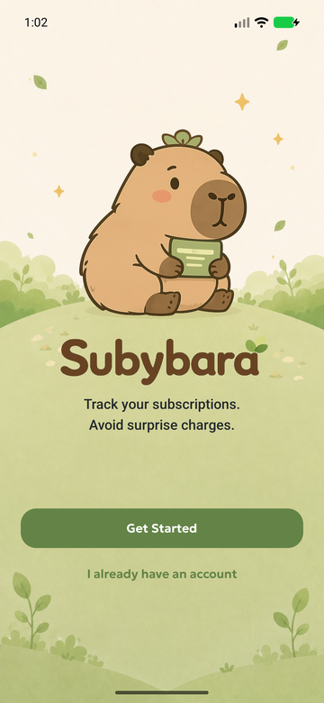
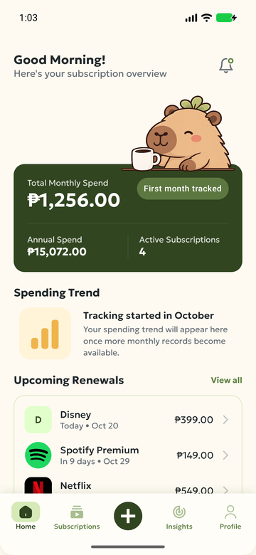
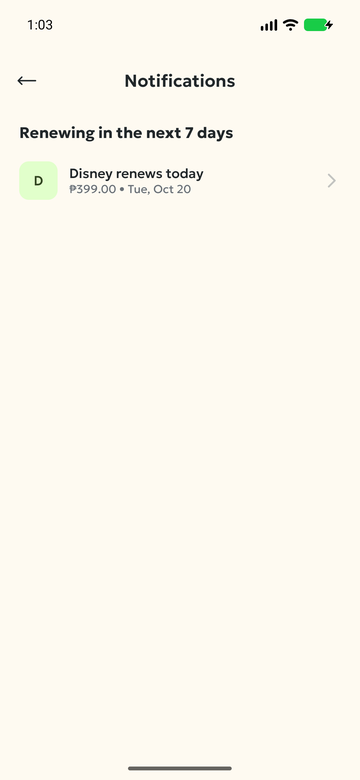
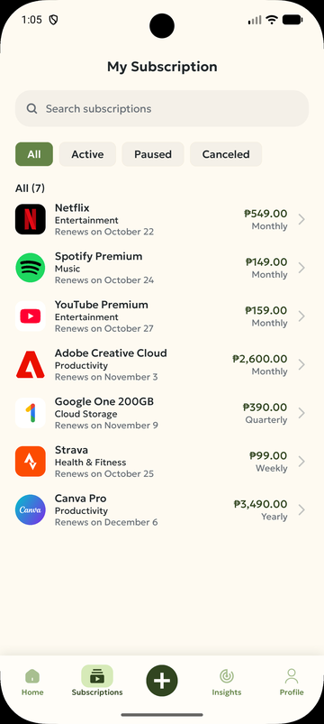
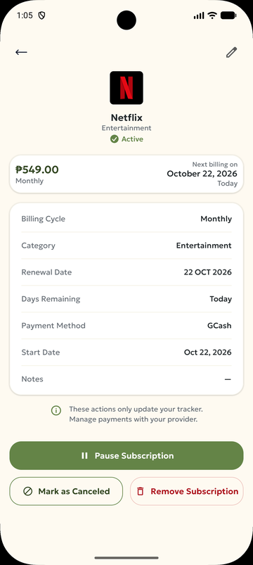
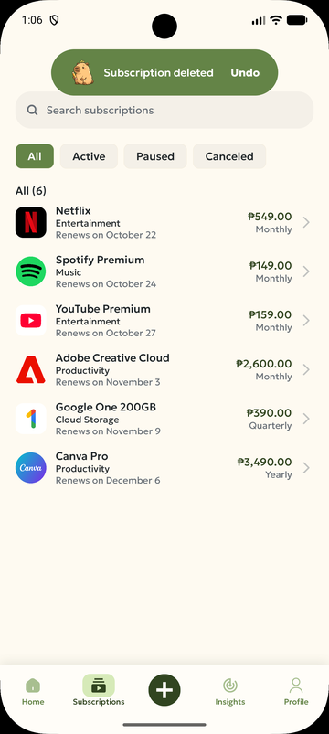
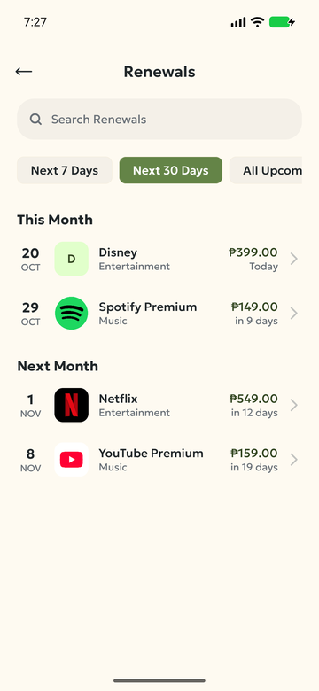
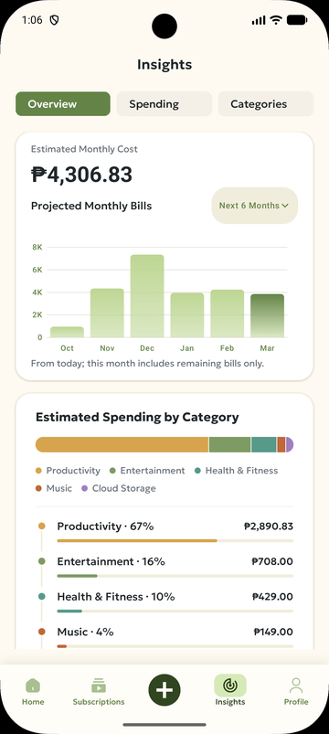

# Subybara

Subybara is an Android subscription tracker built for our Mobile Development course. It helps users keep track of their subscriptions, estimated costs, and upcoming billing dates in one place.

Subscriptions are entered manually. Subybara only tracks them: it does not process payments or cancel subscriptions with service providers.

## Screenshots

| Welcome | Dashboard | Notifications | My Subscription |
|---|---|---|---|
|  |  |  |  |

| Subscription details | Undo after removing | Renewals | Insights |
|---|---|---|---|
|  |  |  |  |

## Features

- **Account (prototype):** Welcome, Sign In, Sign Up, Forgot Password, and Profile screens with input validation.
- **Subscriptions:** add, edit, search, and filter subscriptions by status (Active, Paused, Canceled). Each subscription can have a custom logo picked from the photo library.
- **Subscription details:** pause, resume, or cancel tracking, and remove a subscription with an **Undo** option.
- **Dashboard:** estimated monthly and annual cost, active subscription count, upcoming renewals, and spending insights.
- **Renewals:** upcoming billing dates grouped by month, with search and 7-day, 30-day, and all-upcoming filters. Past billing dates roll forward to the next cycle.
- **Home and Insights charts:** a shared six-month forecast, displayed as a green line on Home and vertical bars in Insights. Overview, Spending, and Categories tabs show estimated costs and a stacked category breakdown.
- **Notifications (in-app):** reminders for active subscriptions renewing within 7 days, with an unread indicator on the dashboard bell.
- **Usability:** the system Back button returns to the previous screen, state survives screen rotation, screens scroll in landscape, and layouts adapt to larger font sizes.

All costs are **estimates** based on each subscription's price, billing cycle, and billing dates. Only active subscriptions are counted.

## MS2 Demo Account

- **Email:** `test@email.com`
- **Password:** `Test1234!`

Choose **I already have an account** on Welcome to sign in. The demo loads seven sample subscriptions covering weekly, monthly, quarterly, and yearly billing, with upcoming renewals and notification reminders. These are evaluation examples, not current provider price quotes.

New signups start empty. Each email keeps a separate subscription list in memory, including across logout and account switching. Repeat demo logins retain edits and do not duplicate or reseed subscriptions, even if all demo records are deleted. Closing the app process resets accounts and data. Authentication remains simulated; the reserved demo email requires the password above.

## Technologies Used

- **Kotlin** and **Jetpack Compose** with **Material 3**
- **Compose state** (`mutableStateListOf`, `rememberSaveable`) for app data and screen state
- **Custom Compose navigation** (sealed destinations and `BackHandler`)
- **Android photo picker** for custom logos (no storage permission needed)
- **JUnit 4**, **Compose UI Test**, and **Espresso** for testing
- **Gradle** (Kotlin DSL) for builds

Minimum SDK 24, target SDK 36.

## Architecture

Subybara is a single-activity app built entirely with Jetpack Compose:

```
MainActivity → SubybaraApp (theme) → SubybaraNavHost → feature screens
```

- **Navigation:** every screen is a `data object` in the sealed `SubybaraDestination` interface. `SubybaraNavHost` keeps the current route in `rememberSaveable` and shows one screen at a time.
- **Data:** `SubscriptionStore` and `AccountStore` hold the app's data in Compose state and act as the single source of truth, so screens update automatically when data changes.
- **UI:** screens receive data as parameters and send user actions back through callbacks (state hoisting and unidirectional data flow).
- **Logic:** cost, renewal, and date calculations are pure Kotlin functions in `core/model`, separate from the UI so they can be unit tested.

### Project structure

```
app/src/main/java/com/subybara/app/
├── MainActivity.kt, SubybaraApp.kt
├── core/
│   ├── data/            SubscriptionStore, AccountStore
│   ├── designsystem/    Theme and reusable components
│   ├── model/           Subscription, UserAccount, calculations, date helpers
│   └── util/            AccountValidator
├── feature/
│   ├── account/         Welcome, Sign In, Sign Up, Forgot Password
│   ├── home/            Dashboard
│   ├── insights/        Insights
│   ├── notifications/   Notifications
│   ├── profile/         Profile
│   ├── renewals/        Renewals
│   └── subscriptions/   List, details, add/edit form, dialogs
└── navigation/          Destinations and NavHost
```

## Getting Started

**Requirements:** a recent version of Android Studio (with JDK 17 or newer) and an emulator or device running Android 7.0 (API 24) or newer.

1. Clone the repository:
   ```bash
   git clone https://github.com/MsYelkyy/Subybara-Subscription-Tracker-App.git
   ```
2. Open the project in Android Studio and let Gradle sync.
3. Select an emulator or connected device and click **Run**.

To build from the command line:

```bash
./gradlew assembleDebug
```

## Testing

- **Unit tests** (`app/src/test`) cover the cost and renewal calculations, date handling, the subscription store, and account validation.
- **UI tests** (`app/src/androidTest`) cover the main user flows: adding, editing, and removing subscriptions, Undo, status changes, notifications, renewals, custom logos, screen rotation, and Back navigation.

```bash
# Unit tests (no device needed)
./gradlew testDebugUnitTest

# UI tests (needs a running emulator or connected device)
./gradlew connectedDebugAndroidTest

# Lint
./gradlew lintDebug
```

## Known Limitations

- **Data is stored in memory only.** Subscriptions and account details reset when the app closes.
- **Sign in is simulated.** There is no server, and Forgot Password does not send an email.
- **No payment history.** Charts project bills from today through the end of the next five months. The first month includes only remaining bills. Amounts, cycles, renewal dates, and active status are assumed to stay unchanged.
- **Notifications are in-app only.** There are no push notifications, and read reminders reset when the app closes.
- At very large font sizes, long subscription names in lists are shortened with "…".
